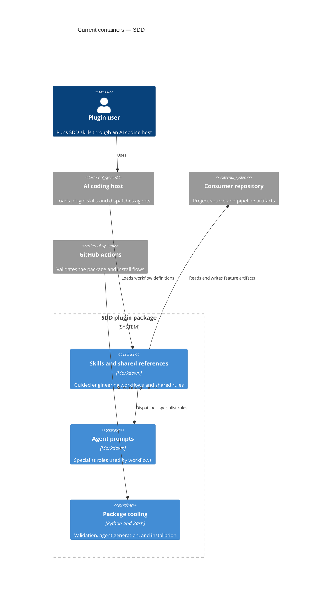

# Architecture map — SDD

> The current architecture of this documentation and plugin package. Pipeline skills produce
> artifacts in consumer repositories; this repository does not dogfood those generated artifacts.

## Stack

- Language / runtime: Markdown is the primary content format; Python 3.x validation/generation tooling and Bash installer (`.github/workflows/validate.yml:20-23`; `install.sh`).
- Frameworks: None; this is a cross-host plugin package, not an application (`plugin.json:1-33`).
- Build / test / lint: No build or unit-test command is defined. CI runs the structural validator and generated-agent consistency check (`.github/workflows/validate.yml:17-23`); installer smoke checks include `bash -n` and ShellCheck (`.github/workflows/validate.yml:33-35`).

## C4 — system as it is

## Module inventory

| Module | Path | Layers | Wired at | Responsibility |
|---|---|---|---|---|
| Skills | `skills/<name>/` | Workflow instructions, references, templates | `plugin.json:1-33` | 23 stage workflows for consumer projects |
| Shared rules | `skills/_shared/` | Cross-skill contracts and conventions | `skills/_shared/handoff.md:1` | Single source for pipeline-wide behavior |
| Canonical agents | `agents/` | Specialist prompts | `README.md:367` | Source definitions for bounded agent roles |
| Copilot agents | `com.github.copilot/agents/` | Generated host-specific prompts | `scripts/generate_copilot_agents.py` | Generated variants; do not hand-edit |
| Tooling | `scripts/` | Validation and generation | `.github/workflows/validate.yml:17-23` | Enforces package contracts and generated-file consistency |
| Installer | `install.sh` | Cross-host distribution | `.github/workflows/validate.yml:33-35` | Installs/uninstalls skills and host agents with rollback |
| Evaluation scenarios | `evals/` | Manual behavior evaluations and fixtures | `evals/README.md:1-8` | On-demand workflow evals; fixtures are not production modules |
| Manifests and CI | `plugin.json`, `.claude-plugin/`, `.codex-plugin/`, `.cursor-plugin/`, `.agents/`, `.github/` | Host registration and automation | `plugin.json:22-33` | Declares package metadata, host integrations, and CI |

## Conventions (cited — the rules a new feature must match)

- **Module wiring / registration:** Skills are directories with `SKILL.md`; Copilot agent files are explicitly registered in the plugin manifest (`plugin.json:22-33`).
- **Error handling:** Python validation uses a shared `check(...)` helper that reports failures and exits non-zero (`scripts/validate_plugin.py:24-37`).
- **IDs:** No repository-wide runtime/domain ID convention; the package defines workflows, not domain entities.
- **Persistence / DB access:** No datastore. Workflows read and write ordinary files in the consumer repository; project-local SDD settings are gitignored (`.gitignore:1-3`).
- **Migrations:** None in this repository; migration artifacts are produced for consumer projects by the data-model workflow (`skills/data-model/SKILL.md`).
- **Tests:** CI runs structural validation and generated-agent drift checks; installer smoke tests exercise install, rollback, and uninstall (`.github/workflows/validate.yml:17-23`, `.github/workflows/validate.yml:33-35`). No unit-test suite is present.
- **Inter-module communication:** Skills pass state through repository artifacts and stage handoffs (`skills/_shared/handoff.md:1`).
- **UI / styling:** N/A — this package has no frontend.

## Datastores

| Store | Engine | Accessed via | Notes |
|---|---|---|---|
| None | N/A | N/A | Package has no runtime datastore; consumer-project artifacts are files in the consumer repository. |

## Frontend / UI foundation

<!-- N/A: no frontend -->

## Where things live / closest precedents

- A new workflow stage belongs in `skills/<name>/`, modelled on the existing `SKILL.md` + references/templates pattern (`plugin.json:1-33`).
- A new cross-skill rule belongs in `skills/_shared/` and should be linked from relevant skills (`skills/_shared/handoff.md:1`).
- A new agent starts in `agents/`; regenerate host variants with `scripts/generate_copilot_agents.py` and update explicit manifest registration (`scripts/generate_copilot_agents.py`; `plugin.json:22-33`).
- A new package validation belongs in `scripts/validate_plugin.py` and its CI invocation (`scripts/validate_plugin.py:24-37`; `.github/workflows/validate.yml:17-23`).
- A new distribution behavior should follow the install/rollback precedent in `install.sh` and its smoke workflow (`install.sh:2-23`; `.github/workflows/validate.yml:33-35`).

## Constraints & known tech-debt

- Copilot agent definitions are generated from `agents/`; edit the canonical source and regenerate rather than editing generated files (`scripts/generate_copilot_agents.py`).
- Adding an agent requires updating the explicit Copilot agent list in `plugin.json` (`plugin.json:22-33`).
- Evals are on-demand behavior checks, not CI tests; their embedded Go/SQL repositories are fixtures, not maintained production modules (`evals/README.md:1-8`).
- Keep workflows stack-agnostic; avoid imposing a specific language, test framework, tracker, or build tool on consumer projects (`CONTRIBUTING.md:14`, `CONTRIBUTING.md:52`).

## Reconciliation with the authored architecture doc

No authored architecture document or root `CLAUDE.md` exists; this map is the current repository reference. No ADRs exist outside evaluation fixtures.
