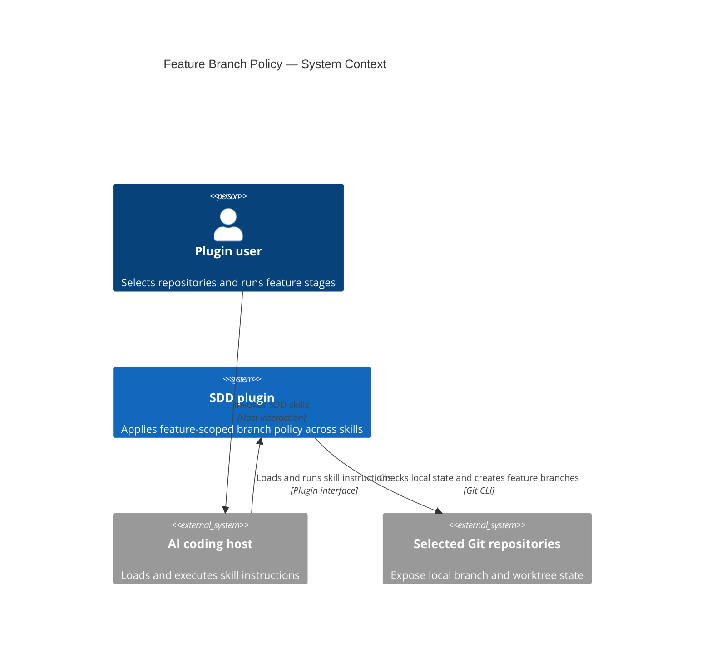
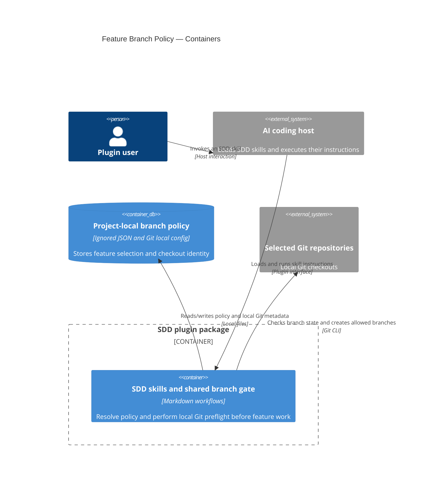

# Software Architecture Document — new-branch-per-feature

## 1. Introduction and goals

**Intent.** Add an opt-in, feature-scoped branch policy to the SDD plugin so Plugin users can keep planning and implementation isolated across explicitly selected Git repositories. The shared policy must run before any stage write and repeat before feature writes and commits, preserve existing behavior for non-opted-in features, and fail safely when repository or branch state is unsafe.

**Top-3 quality goals (1-liners; full scenarios in §10):**

1. **Safety:** unsafe or mismatched repository state blocks feature writes and commits across the entire selected repository set.
2. **Coverage:** every registered SDD skill invokes the same feature-scoped gate while a policy applies.
3. **Performance:** branch preflight meets the response target defined in §10, excluding branch creation and owner interaction.

**Stakeholders.**

| Role | Interest | Sign-off owner? |
|---|---|---|
| Plugin user | Opt in, select repositories, and safely run feature stages | No |
| Tech Lead | Architecture, shared gate, and repository-state policy | Yes |
| Security Lead | Path validation and fail-closed behavior | Yes |

**Decision:** Do not ship or rely on host-level branch-check hooks. The mandatory skill-level gate remains the single source of truth; see ADR-0005.

## 2. Constraints

**Technical.**
- The product is a cross-host plugin package built primarily from Markdown skill instructions, with a Bash installer and Python 3.x validation/generation tooling.
- No application framework or runtime datastore exists in this repository; feature state is local workspace metadata, not a server-side database.
- Git is the repository-operation interface. The feature must not require a consumer project's language, framework, or database stack.
- If repository discovery needs an agent, use the existing low-cost search/read role; branch-state checking itself is deterministic and does not dispatch a judgment agent.

**Organisational.**
- The change spans the shared workflow contract, all 23 registered skill entrypoints, host capability documentation, and CI validation; it does not install host hooks.
- No delivery deadline or effort budget is specified; these remain planning inputs rather than architecture constraints.
- The Plugin user explicitly opts in and selects repositories; the feature never enrolls other repositories implicitly.

**Conventions.**
- Shared behavior belongs in `skills/_shared/` and is referenced by skills; validators enforce cross-skill contracts in `scripts/validate_plugin.py`.
- Project-local settings follow `skills/_shared/settings-file.md`; feature artifacts use progressive writes and path-scoped commits per `skills/_shared/write-and-commit.md`.
- Failures are explicit and stop work; malformed or unverifiable opted-in branch state must not inherit fail-open settings defaults.

**Regulatory / external.**
- No personal data or new identity system is involved. Repository paths and branch names are internal local project metadata.
- No remote branches, permissions, or remote repository state are inspected or modified; local filesystem write permission governs branch creation.

## 3. Context and scope

The SDD plugin guides a Plugin user through feature planning and implementation in one or more local Git repositories. The new policy coordinates those repositories around a feature-slug branch and prevents any stage from writing or committing when the selected repository set is unsafe or inconsistent. AI coding hosts load and execute the skills; host hook capabilities are informational only and are not part of branch-policy enforcement.

<!-- brownfield: Current repo is a docs-first, cross-host plugin; skills are instruction files, shared rules are referenced contracts, and CI validates skill structure. No branch-policy runtime or hook infrastructure exists yet. -->

**External systems (in / out):**

| Actor or system | Type | Interaction |
|---|---|---|
| Plugin user | Person | Opts in, chooses repositories, invokes skills, and resolves unsafe branch state |
| AI coding host | External system | Loads and executes SDD skill instructions |
| SDD plugin package | System | Applies shared branch policy and coordinates stage work |
| Selected Git repositories | External systems | Provide local branch, worktree-status, default-branch, and write-permission state |

**C4 Context (L1):**



## 4. Solution strategy

**Target surface:** `library-sdk`. The SDD plugin is a host-loaded package of reusable skill workflows; it is not a standalone terminal application or a user-facing UI. This is the closest supported surface in the repository's taxonomy, so downstream stages should treat host skill invocations as the package interface.

**Top strategic choices (the seeds for ADRs):**

1. **Use one shared instruction-based branch gate.** `skills/_shared/branch-policy.md` is the canonical procedure; every registered skill invokes it before any stage write, including settings/bootstrap/status changes, and repeats it before feature writes and commits. CI verifies entrypoint coverage. This matches the documentation-first plugin architecture without adding a runtime dependency, though it cannot technically intercept arbitrary actions outside SDD skills.
2. **Keep policy state local and branch-independent.** Store feature opt-ins, selected canonical repository paths, and the active feature in `.sdd/branch-policy.json` at the root of the repository containing the SDD documents; ignore that file with a local `.git/info/exclude` entry. Assign each selected checkout a stable local UUID in its `.git/config` so replacement or relocation cannot be accepted by path name alone.
3. **Preflight the whole repository set before branch creation.** Create a missing exact feature-slug branch only from a clean current branch whose name begins with the case-sensitive literal prefix `main`, `master`, `develop`, or `release`, or exactly matches that checkout's locally recorded default branch. A repository already on its exact target branch passes identity and branch checks even with a dirty worktree; an existing target branch that is not active blocks setup and requires manual activation. Branch creation does not check out the branch; the Plugin user activates target branches manually. Persist setup as `pending` until every selected repository is on the target branch, then mark it `active`. Do not switch to any branch, stash, reset, delete, or roll back. If branch creation fails partway through, report every repository and preserve already-created branches without starting feature work.
4. **Rely on the shared skill gate without shipping host branch-check hooks.** Host hook support and trust vary, and separate host checks would duplicate policy behavior. The shared gate is the only required check; host hook capabilities may be described as informational context, but hooks are not installed, relied on, or part of this feature.

These choices implement the product constraints in spec §1 and §5. A mismatch in any selected repository blocks the whole stage before any stage write; a dirty worktree is allowed only after the feature branch is already active. Discovery stays within the project workspace unless the Plugin user explicitly selects another path. Project-wide invocations use the explicitly active feature, and an absent or ambiguous selection stops before stage writes. Features without this opt-in retain the existing `branch_strategy` behavior unchanged.

## 5. Building block view

This is a documentation-centered policy layer inside the existing SDD plugin. One shared Markdown contract owns the branch rules; registered skill entrypoints invoke it before any stage write, including settings/bootstrap/status changes, and the package validator checks coverage. During policy initialization, that entry gate uses the setup-mode preflight in Flow 1 before local metadata writes or branch creation; after initialization, Flow 2 verifies the active feature branch. The gate is repeated before feature writes and commits. Git CLI reads and updates local repository state directly; there is no new runtime service or datastore.

**Internal decomposition:**

```
skills/
├── _shared/branch-policy.md      canonical policy, state format, Git preflight and recovery rules
└── */SKILL.md                    each registered entrypoint invokes the gate before any stage write
scripts/
└── validate_plugin.py            checks every registered skill entrypoint references the gate
consumer repository/
├── .sdd/branch-policy.json       ignored policy, active feature, setup status, selected paths, and checkout UUID map
└── .git/
    ├── info/exclude              local ignore rule for policy state
    └── config                    local checkout UUID for identity validation
```

**C4 Container (L2):**



## 6. Runtime view

Before any Git command in either flow, the shared gate validates the feature slug and every discovered, user-supplied, or saved repository path as data. The allowed path set is the project workspace plus canonical Git roots explicitly selected by the user, including roots outside the project workspace; reject command-like values, unselected external paths, and path escapes outside that set. Outside an explicit opt-in initialization request, absent policy state or a uniquely resolved unopted feature means the gate is a no-op and the legacy workflow continues unchanged. An explicit opt-in request always enters Flow 1, even before policy state exists. When policy state is in use, a project-wide invocation must resolve exactly one explicitly active feature; if zero or multiple features are active, it stops and requests an explicit slug before any feature writes or commits.

**Critical flow 1: Initialize feature policy**

```mermaid
sequenceDiagram
    actor User as Plugin user
    participant Host as AI coding host
    participant Gate as Shared branch gate
    participant State as Local policy state
    participant Repos as Selected Git repositories
    User->>Host: Enable policy or resume pending setup
    Host->>Gate: Begin or resume feature initialization
    Gate->>Repos: Discover eligible independent checkouts if initial setup
    Repos-->>Gate: Candidate repositories
    Gate-->>User: Require explicit selection including the documents repository if initial setup
    User->>Gate: Select repositories if initial setup
    loop Initial setup or pending retry
        Gate->>Repos: Preflight all selected repositories
        Repos-->>Gate: Identity, branch, cleanliness, and permission results
        alt Any repository fails preflight
            Gate-->>User: Report each selected repository's status and stop before setup writes
        else Every repository passes preflight
            Gate->>Repos: Add or verify local exclude rule; assign or reuse checkout UUIDs
            Repos-->>Gate: Local metadata write results
            alt Any local metadata write fails
                Gate-->>User: Report every selected repository's setup result; stop before saving policy or creating branches
            else All local metadata writes succeed
                Gate->>State: Atomically save or update policy as pending with selection and complete UUID map
                alt Policy state write fails
                    State-->>Gate: Error; prior valid state retained or absent on initial setup
                    Gate-->>User: Report every repository and state-path result; stop before branch creation
                else Policy state saved
                    State-->>Gate: Pending policy state
                    alt Every target branch is already active
                        Gate->>State: Mark setup active
                        Gate-->>Host: Allow the feature stage to begin
                    else One or more target branches are missing
                        Gate->>Repos: Create missing slug branches from approved clean bases
                        Repos-->>Gate: Per-repository branch setup results
                        alt Any branch setup operation fails
                            Gate-->>User: Report all repository states; preserve completed changes and pending state
                        else Missing branches created
                            Gate-->>User: Require manual activation; keep setup pending and stop feature work
                        end
                    end
                end
            end
        end
    end
```

The documents repository is mandatory in the selected set because it anchors the policy file. The all-repository preflight is read-only and completes before setup mutations. A repository already on its target branch needs identity and branch verification but may be dirty; a repository needing a new branch must be clean, on an approved base, and able to write its Git metadata. An existing target branch that is not active fails preflight before any setup mutation, so the user must activate it manually and retry. After preflight passes, the gate adds or verifies the policy-file pattern in the documents checkout's local `.git/info/exclude`, then assigns or reuses a UUID in every selected checkout's `.git/config`. Only after all UUID writes succeed does it atomically save or update the policy as `pending` with the complete UUID map, before creating any missing branches. If saving state fails, the previous valid state remains unchanged (or no file exists on initial setup), every repository and the state path are reported, and no branch is created; local excludes and UUIDs remain safe to reuse on retry. UUID assignment is idempotent, so a retry can reuse IDs written before a prior setup stopped; no partial UUID map is saved. Branch creation never checks out a branch. The Plugin user must activate newly created target branches manually and resume initialization; only a complete all-repository branch check changes setup status to `active` and allows feature work. A retry in `pending` state always uses the full Flow 1 setup preflight, not the Flow 2 active-policy gate. The local exclude does not dirty the tracked worktree. If setup fails partway through, the exclude entry, pending policy state, checkout IDs, and already-created branches remain; a retry rechecks all repositories, applying clean-base requirements only where a branch is still needed.

**Critical flow 2: Guard a feature stage**

```mermaid
sequenceDiagram
    actor User as Plugin user
    participant Host as AI coding host
    participant Gate as Shared branch gate
    participant State as Local policy state
    participant Repos as Selected Git repositories
    User->>Host: Start an SDD skill for a feature
    Host->>Gate: Run the mandatory branch preflight
    Gate->>State: Resolve feature policy, setup status, and repository selection
    State-->>Gate: Active feature, setup status, and selected identities
    alt Setup status is pending
        Gate-->>Host: Route to Flow 1 setup-resume preflight; do not start feature work
    else Setup status is active
        loop Every selected repository
            Gate->>Repos: Verify identity and active branch
            Repos-->>Gate: Repository-specific result
        end
        alt Any repository is missing, unverifiable, or on another branch
            Gate-->>User: Report the mismatch and block all stage writes and commits
        else Every selected repository is on the exact feature branch
            Gate-->>Host: Allow stage work
            Host->>Gate: Recheck before any stage write, feature write, or feature commit
            Gate->>Repos: Verify all selected branches again
            Repos-->>Gate: Latest repository states
            alt All branches still match
                Gate-->>Host: Allow the requested write or commit
            else Any branch no longer matches
                Gate-->>User: Block the write or commit and explain recovery
            end
        end
    end
```

The entry gate runs before any SDD stage write, including policy-state initialization, settings creation, and task or roadmap status updates; it is repeated before feature writes and commits. Initialization uses the Flow 1 setup preflight until setup is `active`; Flow 2's exact-branch gate applies only afterward. Read-only inspection and explicit recovery actions remain available after a block. A dirty worktree is accepted only when the exact feature-slug branch is already active.

## 7. Deployment view

The feature ships as additional skill instructions and package validation in the existing SDD plugin; it adds no service, worker, or deployed datastore. Each invocation runs locally in the selected workspace through the active AI coding host, and the ignored policy state and checkout identifiers stay on local filesystems. Existing plugin distribution and CI deployment remain unchanged.

**Monitoring:**
- **Metrics:** No telemetry is collected or sent. Package CI will validate skill-entrypoint references; runtime branch behavior and latency are measured in local host-driven acceptance runs, not by the current CI pipeline.
- **Alerts:** The skill reports every repository failure and the required manual recovery action in the host conversation; there is no remote alerting service.
- **Tracing:** Host tool output remains local; no distributed tracing is added.

**Scaling thresholds:**
- There are no replicas to scale. See QG-3 in §10 for the branch-preflight response target and its verification fixture matrix.

## 8. Crosscutting concepts

| Concept | Convention | Where defined |
|---|---|---|
| Logging | Report the affected repository, failed check, and manual recovery; do not emit remote telemetry. | Shared branch-policy contract |
| Authentication | No new user identity or authentication system; rely on local Git and filesystem permissions. Checkout UUIDs identify repository copies only. | Spec §6.1; ADR-0004 |
| Error handling | Outside explicit opt-in initialization, absent policy state means no opt-in: skip the gate and preserve the legacy workflow. For an explicit opt-in or otherwise expected policy, fail closed on missing, malformed, or unverifiable state; block feature writes if any selected repository fails. | Shared branch-policy contract |
| Input validation | Validate slugs and discovered, supplied, or saved repository paths as data; allow canonical Git roots explicitly selected outside the project workspace, but reject command-like values and other external paths before any Git command. | Spec §6.1; shared branch-policy contract |
| ID strategy | Use the exact feature slug as the local branch name and a random local UUID to confirm each selected checkout. | Spec §1; ADR-0004 |
| Internationalisation | Keep machine state and branch slugs stable; host conversation language remains host-controlled. | Existing plugin conventions |
| Observability | CI validates skill-entrypoint references; local host-driven acceptance and benchmark runs measure runtime behavior and latency. No external collection. | Spec §6 |
| Events | Synchronous local preflight and branch setup; no background event flow or queue. | SAD §6 |

## 9. Architecture decisions

| # | Title | Status | Section |
|---|---|---|---|
| 0001 | Treat the SDD plugin as a library-sdk surface | Accepted | §4 |
| 0002 | Use shared instructions for branch checks | Accepted | §4 |
| 0003 | Store policy in an ignored project JSON file | Accepted | §4 |
| 0004 | Identify checkouts with a local Git UUID | Accepted | §4 |
| 0005 | Rely on the shared skill gate without host hooks | Accepted | §4 |

ADR records live under `docs/features/new-branch-per-feature/adr/`.

## 10. Quality requirements

**QG-1. Unsafe-state enforcement**
- **When:** A branch mismatch, dirty setup, missing repository, or branch collision is exercised.
- **Then:** 100% of branch mismatch, dirty setup, missing-repository, and branch-collision cases block before feature writes or commits.
- **How verify:** Run the manual host-driven acceptance matrix with disposable local Git repositories in each supported host; assert no feature artifact writes or commits occur in any unsafe case.

**QG-2. Skill coverage**
- **When:** A skill entrypoint is added or validated in CI.
- **Then:** 100% of registered SDD skills resolve and invoke the shared gate when a feature policy applies.
- **How verify:** CI validator checks every registered skill entrypoint.

**QG-3. Branch preflight performance**
- **When:** Branch preflight runs for each selected repository, excluding branch creation and owner interaction.
- **Then:** p95 ≤ 2 seconds per selected repository.
- **How verify:** In a supported host, time 30 preflight runs against local fixtures containing 1, 3, and 10 repositories; retain results locally as an acceptance benchmark, not a current CI measurement.

## 11. Risks and technical debt

| Risk / debt | Severity | Mitigation | Owner |
|---|---|---|---|
| The shared instruction gate cannot prevent direct file edits or Git operations outside an SDD skill. | High | Require the gate at each skill entry before any stage write and before every feature write/commit; validate all registered entrypoints in CI; document that direct operations are outside enforcement. | Tech Lead |
| A local checkout UUID cannot be written when Git configuration is read-only. | Medium | Check local write permission before branch creation; report each selected repository's result and stop without feature work. | Tech Lead |
| Multi-repository branch creation can fail after earlier repositories have created their branches. | Medium | Report every repository's result, preserve created branches, and require manual recovery; never roll back or switch branches automatically. | Plugin user |
| Malformed policy state or a replaced repository path can block otherwise valid work. | Medium | For an expected opted-in policy, fail closed, report the exact state/path problem, and ask the user to repair or explicitly reselect; never substitute a parent or similarly named repository. | Tech Lead |

**Accepted debt (acceptable in v1, plan to fix later):**
- No shipped host-level branch-check hook; direct operations outside SDD skills are not blocked by this policy.

## 12. Glossary

| Term | Meaning |
|---|---|
| Plugin user | A person who runs SDD skills through an AI coding host; not a Plugin maintainer. |
| Active feature | A feature explicitly selected as active in the project's local state; it remains active until the user changes that selection. |
| Setup status | `pending` while branches need setup or manual activation; `active` only after every selected repository is on the exact feature branch. |
| Feature-slug branch | The local Git branch whose name exactly matches the feature slug, without a prefix. |
| Selected repository | An explicitly chosen independent Git checkout participating in a feature policy; submodules and linked worktrees are excluded. |
| Checkout UUID | A random local identifier stored in a selected repository's Git configuration to confirm that the saved path still identifies the same checkout. |
| Shared branch gate | The required `skills/_shared/branch-policy.md` procedure that each SDD skill runs before any stage write and repeats before feature writes and commits. |
