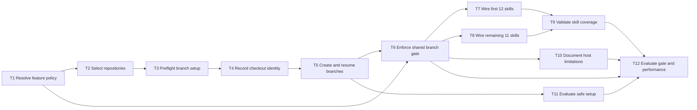

# Epic — new-branch-per-feature

> **Spec:** [spec.md](../spec.md) · **Design:** [sad.md](../sad.md) · **Data model:** none · **API:** none · **ADRs:** [adr/](../adr/)

## Goal

Deliver an opt-in feature branch policy that keeps each feature's planning and implementation on its exact slug branch across explicitly selected local repositories. All registered skills use the same fail-closed gate before stage writes and recheck before feature writes and commits, while features without opt-in retain the legacy workflow.

## Scope

- **In:** Local policy state and feature resolution; explicit repository discovery and selection; safe setup, checkout identity, and branch lifecycle; shared stage/write/commit gate; all 23 skill entrypoints; CI coverage validation; informational host documentation; acceptance evaluations.
- **Out:** Host-level enforcement hooks, remote branch or permission operations, automatic checkout/stash/reset/delete, and database, HTTP, CLI, or UI surfaces.

## Task map

## Tasks

See [tracker.md](./tracker.md) for status. Machine contract: [tasks.json](../tasks.json).

| # | Task | Layer | Blocked by | DoD (short) |
|---|---|---|---|---|
| T1 | Define local policy state and active-feature resolution | app | — | Opted-in state resolves explicitly; ambiguous project-wide calls block writes; unopted features preserve legacy behavior. |
| T2 | Discover and explicitly select eligible repositories | app | T1 | Only validated independent checkouts are selectable; the documents checkout is mandatory. |
| T3 | Enforce safe branch-setup preflight | app | T2 | Dirty or unapproved bases and inactive target-branch collisions stop setup without mutation. |
| T4 | Record checkout identity and verify local write access | app | T3 | Every selected checkout's UUID and required metadata writes are verified before feature artifacts. |
| T5 | Create feature branches and resume pending setup | app | T4 | Missing slug branches are created without checkout; setup remains pending until manual activation and full verification. |
| T6 | Enforce the shared branch gate at every write boundary | app | T1, T5 | Every selected repository is checked before stage writes and rechecked before feature writes and commits. |
| T7 | Wire the first 12 registered skills to the gate | wiring | T6 | Twelve named skill entrypoints invoke the shared gate before stage writes and at write/commit boundaries. |
| T8 | Wire the remaining 11 registered skills to the gate | wiring | T6 | The other eleven skill entrypoints invoke the same gate at the required boundaries. |
| T9 | Validate branch-gate coverage in CI | tests | T7, T8 | CI fails if any registered skill entrypoint omits the shared branch-policy reference. |
| T10 | Document host-hook information as non-enforcing | docs | T6 | Host capabilities are informational and never described as required enforcement. |
| T11 | Add safe-setup acceptance evaluation scenarios | tests | T5 | Evaluation fixtures cover setup preconditions, failures, recovery, and preserved state. |
| T12 | Add active-gate and performance evaluation scenarios | tests | T6, T9, T10, T11 | Evaluation covers cross-repository gate behavior, legacy no-op, host limitations, and the specified benchmark. |

## Risks / Hard rules

- Validate feature slugs and every discovered, supplied, or saved repository path as data before Git operations.
- Never switch branches automatically, stash, reset, delete, roll back completed branch creation, or change remote state.
- The target branch is exactly the feature slug; create it only from a clean approved current base.
- The shared gate is required; host hooks are not installed or relied on.
- A mismatch in any selected repository blocks the whole stage's feature writes and commits.
- No database schema, HTTP API, CLI application, or UI is introduced.

**Total:** 12 tasks, ~9 person-days.
